# Quantpet Distribution System: plan v0 (bản nháp để thảo luận)

20/11/2026. Bản nháp để thảo luận: cách dựng một workflow distribution từ tìm lead đến chuyển đổi, rồi tự động hoá. Phần chính 1 trang, chi tiết ở phụ lục.

## Phần chính

**Tóm tắt**
- **Mục tiêu:** dựng một distribution system có AI hỗ trợ: tìm lead, xếp hạng, có sẵn hook, có owner, có follow-up.
- **Cách làm:** chạy thử một vòng nhỏ với 30 người bằng tay cộng AI trước. Chỗ nào lặp lại mới tự động hoá. Không build platform trước.
- **Nút cổ chai:** chưa có số thật của bot (CPM, CPP), nên hook, DM và deal sàn đều phải chờ.

**Vấn đề:**
- Cách cũ là lọc list, DM từng người, một BD tự xử lý. Cách này tốn thời gian, khó follow-up, khó chia việc, mất lead vì người ta thấy không được chăm sóc.
- App như fomo cho thấy phân phối có hệ thống thắng. CRM kiểu truyền thống sẽ quan trọng ở web3.

**Đích và mốc** (thước đo là đề xuất, cần bàn):
| Mốc | Định nghĩa | Thước đo đề xuất |
|---|---|---|
| Mốc 1: 100 power user | 100 người đúng ICP đã thấy Quantpet và được tiếp cận đúng cách | 100 người trong sheet có owner. 30 người đã dùng thử. 10 người có volume đều mỗi tuần |
| Đích: distribution system tự chạy | Lead mới, follow-up, hook và deal sàn chạy đều mỗi tuần mà không phụ thuộc một người | Radar cộng đồng và báo follow-up chạy hằng tuần. Mỗi lead một owner. Tỷ lệ từng bước của phễu đo được |

**ICP (chân dung khách hàng lý tưởng), 4 nhóm:**
1. Người farm point bằng bot (TreadFi, Vesper, XYZD, tự code).
2. Whale perp.
3. KOL trading và farm.
4. Quỹ hoặc MM nhỏ.

Sàn và dự án là luồng B2B riêng.

**6 nhánh:**
| Nhánh | Là gì | Ra cái gì | Cần nhánh nào trước |
|---|---|---|---|
| R. Framework | Khung kiến thức đủ để làm bước kế tiếp | Hiểu ICP và tín hiệu (Clay), hiểu MM và bot | — |
| A. Số thật | Chứng minh product bằng số | CPM, CPP thật, so với đối thủ, thẻ số công khai | — |
| B. Lead | Tìm và xếp người cần tới | Sheet 100 power user, bản đồ circle, danh sách KOL B/C | R |
| C. Hook và KOL | Làm cho target thấy Quantpet rồi mới tiếp cận | Offer, hook kit, KOL đăng, DM, đo phễu | A, B |
| D. Sàn (B2B) | Deal incentive với sàn | Tờ deal "sàn trả $X mỗi $1M", cuộc thi volume, leaderboard | A |
| E. Tự động hoá | Biến việc lặp lại thành hệ thống | Sheet có owner, radar tuần, báo tín hiệu ấm, July báo sáng, bảng CPM công khai | B, C |

**Workflow một vòng** (mỗi bước ra một thứ, là đầu vào của bước sau):
1. **Số thật:** chạy bot nhỏ 7 ngày → CPM, CPP → thẻ số công khai.
2. **ICP và sheet:** 4 nhóm ICP → cột sheet → lead từ 3 nguồn (on-chain, X, cộng đồng) → sheet 30 người.
3. **Circle:** với mỗi target, KOL nào họ hay tương tác → xếp KOL B/C theo số target chạm được.
4. **Hook kit:** one-pager, FAQ từ câu hỏi thật, mẫu bài KOL, thẻ số, tờ deal sàn.
5. **Cho thấy rồi mới tiếp cận:** có mặt trong group bằng số → người dẫn dư luận thử và nói → KOL B/C đăng → target tương tác.
6. **Tiếp cận và theo dõi:** DM target đã thấy → trạng thái, owner, follow-up → đo phễu.
7. **Tự động hoá chỗ lặp lại:** radar cộng đồng, báo tín hiệu ấm, báo follow-up mỗi sáng, làm giàu lead.
8. **Lặp lại vòng với 100 người,** rồi với cộng đồng và sàn mới.

**Bắt đầu từ đâu** (đợt 1–3 trong cây, phụ lục B): chạy bot lấy số đầu tiên; định nghĩa ICP và cột sheet; lập sheet 30 người đầu; vẽ thử bản đồ circle 10 người; đóng gói cách phân tích group thành mẫu dùng lại.

**Chỗ còn mở trong workflow:** offer cho KOL và power user (chia ref, trả theo bài, hay quyền dùng sớm); nền CRM (sheet cộng script, Clay, Attio); venue cho vòng đầu (Lighter hay Ondo).

---

## Phụ lục A. Chi tiết từng nhánh

**R. Framework**
- Clay University: chỉ phần ICP, enrichment, outbound theo tín hiệu. Bỏ cold email.
- MM và bot: đủ để giải thích hook cho đúng.
- Chưa cần framework cho YouTube và TikTok, chưa cần dựng CRM từ đầu.

**A. Số thật**
- Các bước:
  1. chốt cặp chạy thử;
  2. chạy 7 ngày;
  3. đo volume, PnL, CPM;
  4. so với TreadFi và XYZD;
  5. ước CPP theo campaign sàn;
  6. làm thẻ số công khai.
- Thêm các tính năng XYZD bỏ ngỏ mà user xin nhiều lần: stop loss rõ ràng, mục tiêu volume rồi tự dừng, hẹn giờ ngoài phiên Mỹ, CPP ước tính trước khi chạy.
- Lưu ý: hiện engine chỉ hứa chi phí mỗi $1M có trần, chưa phải có lời. Chưa nên dùng câu "farm cost dương".

**B. Lead**
- Nguồn:
  - on-chain: leaderboard Hyperliquid, Lighter;
  - X: người đăng volume TreadFi, Vesper;
  - cộng đồng: group của bot đối thủ.
- Ghép tên Telegram với X handle và ví, rồi vào sheet.
- Cột sheet: ai, nhóm ICP, tier, bằng chứng, circle, owner, trạng thái, sàn đang farm, CPP chịu được, có link affiliate không, tính năng đã xin, lần cuối đăng số.
- Bản đồ circle: với mỗi target, KOL nào họ hay tương tác. Xếp KOL B/C theo số target chạm được, ưu tiên KOL chung circle.

**C. Hook và KOL**
- **Hook kit:** one-pager, FAQ 10 câu (lấy từ câu hỏi thật trong group), mẫu bài cho KOL, thẻ số, tờ deal cho sàn.
- **Luật chọn KOL:** khán giả là người trade perp, và KOL tự chạy đủ volume (ví dụ 500k) mới vào chương trình.
- **Thứ tự:**
  1. có mặt trong group bằng số thật;
  2. DM 3–5 người dẫn dư luận;
  3. 5–10 KOL B/C đăng bài;
  4. theo dõi target nào tương tác;
  5. DM target đã thấy;
  6. đo phễu (thấy, nói chuyện, dùng thử, có volume).

**D. Sàn**
- Mỗi sàn đang nóng có một tờ: incentive gì, BD là ai, đối thủ deal ra sao, Quantpet mang được bao nhiêu volume.
- **Mẫu deal đã có người làm được:** Lighter trả XYZD $100 mỗi $1M volume cho user chạy bot, tối đa $100M, có leaderboard và sheet trả thưởng công khai. Một deal như vậy vừa là B2B, vừa là hook, vừa là content.

**E. Tự động hoá** (làm sau khi vòng 30 người chạy tay xong)
- Nhân bản skill `leads` (đang dùng cho Harmonix) sang sheet Quantpet, thêm cột owner. Skill này có sẵn trạng thái Needs reply / Waiting / Active / Quiet và đếm ngày chờ.
- Radar cộng đồng mỗi tuần: power user mới, sàn mới nổi, đối thủ bị chê. July gửi bản tóm 5 dòng.
- Báo tín hiệu ấm: target vừa like hoặc reply bài KOL thì báo owner.
- Bảng CPM, CPP công khai theo sàn và cặp: nam châm cho group farm.
- Agent làm giàu lead tự động, khi đã đủ dữ liệu.
- **Tools sẵn có:**
  - `x-cli`: tìm người, vẽ circle;
  - `trends.py`: xếp hạng KOL;
  - `tg-cli`, `discord-cli`: xuất group;
  - `opencli-dm`: DM có người duyệt;
  - `gsheet`: sheet chung.

**Để sau:** cào YouTube và TikTok, database lead cho mọi project, tự build platform CRM, hệ referral (việc của product).

## Phụ lục B. Cây nhiệm vụ

**Cách đọc:**
- Mũi tên A → B nghĩa là xong A mới mở được B.
- Chữ trên mũi tên là thứ A đưa cho B.
- Ô có nhiều mũi tên đi vào thì cần xong tất cả.
- Màu theo nhánh:
  - tím: R framework;
  - xanh lá: A;
  - cam: B;
  - xanh dương: C;
  - vàng: D;
  - chàm: E.
- Ảnh tĩnh kèm theo: [assets/quest-tree.png](assets/quest-tree.png).

**Thứ tự theo đợt** (một ô làm được khi mọi mũi tên đi vào đã xong):
| Đợt | Việc |
|---|---|
| 1 | Chốt cặp chạy thử, phân tích group XYZD (đã có), định offer, luật chọn KOL, mẫu bài KOL, luật chống spam, framework Clay, framework MM |
| 2 | Chạy bot 7 ngày, thêm tính năng XYZD bỏ ngỏ, định nghĩa ICP, FAQ, mẫu phân tích group |
| 3 | Đo CPM, chốt cột sheet, nguồn on-chain, nguồn X, quét thêm group, radar tuần |
| 4 | So CPM với đối thủ, ghép tên–X–ví, danh sách sàn nóng, nhân bản skill leads |
| 5 | Sheet 30 người, tờ incentive sàn, chia owner cho lead, bảng CPM công khai |
| 6 | Ước CPP, sheet 100 người, bản đồ circle, tìm BD sàn |
| 7 | **Thẻ số công khai**, xếp KOL B/C |
| 8 | One-pager, có mặt trong group, tờ deal sàn |
| 9 | Hook kit, chốt cuộc thi volume |
| 10 | DM người dẫn dư luận, KOL đăng bài, leaderboard |
| 11–13 | Theo dõi tương tác, DM target, đo phễu, báo tín hiệu ấm, July báo sáng |
| 14 | **Mốc 1: 100 power user** |
| 15–16 | Agent làm giàu lead, **Đích** |

**Sơ đồ** (50 ô, 78 mũi tên):

```mermaid
flowchart TD
    START(["Level 0: chưa có hệ thống"])

    subgraph R["Nhánh R: Framework"]
        R1["Framework Clay: ICP, enrichment, tín hiệu"]
        R2["Framework MM và bot: đủ để nói hook đúng"]
    end

    subgraph A["Nhánh A: Product proof (số thật)"]
        A1["Chốt cặp chạy thử (ETH Normal)"]
        A2["Chạy bot tiền thật nhỏ 7 ngày"]
        A3["Đo volume, PnL, CPM thật"]
        A4["So CPM với TreadFi và XYZD"]
        A5["Ước CPP theo campaign sàn"]
        A6["Thẻ số công khai"]
        A7["Thêm tính năng XYZD bỏ ngỏ: stop loss, volume target, hẹn giờ"]
    end

    subgraph B["Nhánh B: Lead, circle, cộng đồng"]
        B1["Định nghĩa ICP 4 nhóm"]
        B2["Chốt cột sheet CRM"]
        B3["Nguồn on-chain: leaderboard HL, Lighter"]
        B4["Nguồn X: người dùng TreadFi, Vesper"]
        B5["Nguồn cộng đồng: phân tích group XYZD"]
        B6["Ghép tên Telegram, X handle, ví"]
        B7["Sheet power user v0: 30 người"]
        B8["Bản đồ circle 10 người đầu"]
        B9["Xếp KOL B/C theo số target chạm được"]
        B10["Quét thêm group: Lighter, TreadFi, Vesper"]
        B11["Sheet 100 power user"]
    end

    subgraph C["Nhánh C: Hook, content, KOL"]
        C1["Định offer: chia ref hoặc phí"]
        C2["Luật chọn KOL: khán giả perp, tự chạy 500k"]
        C3["One-pager Quantpet"]
        C4["FAQ 10 câu từ câu hỏi thật của group"]
        C5["Mẫu bài cho KOL"]
        C6["Hook kit hoàn chỉnh"]
        C7["Có mặt trong group: trả lời CPM bằng số"]
        C8["DM 3 đến 5 người dẫn dư luận"]
        C9["5 đến 10 KOL B/C đăng bài"]
        C10["Theo dõi target nào tương tác"]
        C11["DM target đã thấy Quantpet"]
        C12["Đo phễu: thấy, nói chuyện, dùng thử, có volume"]
    end

    subgraph D["Nhánh D: B2B sàn"]
        D1["Danh sách sàn đang nóng"]
        D2["Tờ incentive từng sàn"]
        D3["Tìm BD từng sàn"]
        D4["Tờ deal mẫu: sàn trả X mỗi 1M volume"]
        D5["Chốt 1 cuộc thi volume với một sàn"]
        D6["Leaderboard công khai"]
    end

    subgraph E["Nhánh E: Tự động hoá CRM"]
        E1["Nhân bản skill leads sang sheet Quantpet"]
        E2["Chia owner cho từng lead"]
        E3["Luật chống spam: giới hạn DM, người duyệt"]
        E4["Mẫu phân tích group cố định"]
        E5["Radar cộng đồng mỗi tuần"]
        E6["Báo tín hiệu ấm cho owner"]
        E7["July báo sáng: ai cần follow-up"]
        E8["Bảng CPM, CPP công khai theo sàn và cặp"]
        E9["Agent làm giàu lead tự động"]
    end

    M1{{"Mốc 1: 100 power user dùng Quantpet"}}
    BOSS{{"Đích: Distribution system tự chạy"}}

    START -->|"hiểu cách tìm lead"| R1
    START -->|"hiểu sản phẩm"| R2
    START -->|"cần số trước"| A1
    START -->|"biết tìm ai"| B1
    START -->|"có gì để đưa"| C1
    START -->|"lọc KOL"| C2
    START -->|"không bị ban"| E3
    R1 -->|"cách chia nhóm"| B1
    R1 -->|"cách enrichment"| E9
    R2 -->|"nói đúng về bot"| C3

    A1 -->|"cặp và mức"| A2
    A2 -->|"dữ liệu chạy"| A3
    A3 -->|"CPM của mình"| A4
    A4 -->|"so được với đối thủ"| A6
    A3 -->|"chi phí thật"| A5
    A5 -->|"tiền mỗi point"| A6
    D2 -->|"thưởng của sàn"| A5
    B5 -->|"tính năng user xin"| A7

    B1 -->|"nhóm cần lưu"| B2
    B2 -->|"khung sheet"| B7
    B1 -->|"tìm whale"| B3
    B1 -->|"tìm farmer"| B4
    B3 -->|"ví"| B6
    B4 -->|"X handle"| B6
    B5 -->|"tên trong group"| B6
    B6 -->|"hồ sơ lead"| B7
    B7 -->|"30 target"| B8
    B8 -->|"KOL quanh target"| B9
    B5 -->|"cách làm mẫu"| E4
    E4 -->|"quy trình lặp lại"| B10
    B7 -->|"30 dòng đầu"| B11
    B10 -->|"lead mới"| B11
    C2 -->|"tiêu chí lọc"| B9

    A6 -->|"số để khoe"| C3
    B5 -->|"câu hỏi thật"| C4
    A7 -->|"điểm hơn XYZD"| C6
    C3 -->|"giới thiệu"| C6
    C4 -->|"trả lời sẵn"| C6
    C5 -->|"bài mẫu"| C6
    A6 -->|"số để trả lời"| C7
    B5 -->|"biết group nào"| C7
    C1 -->|"offer"| C8
    C6 -->|"tài liệu kèm"| C8
    C7 -->|"đã có uy tín"| C8
    B9 -->|"danh sách KOL"| C9
    C1 -->|"điều khoản trả"| C9
    C6 -->|"brief bài"| C9
    C9 -->|"bài đã lên"| C10
    B11 -->|"ai cần theo dõi"| C10
    C10 -->|"target đã thấy"| C11
    C8 -->|"người dẫn đã nói"| C11
    C11 -->|"kết quả DM"| C12

    B5 -->|"sàn group đang farm"| D1
    D1 -->|"sàn cần tìm hiểu"| D2
    D2 -->|"biết sàn cho gì"| D3
    D3 -->|"người để chào"| D4
    A6 -->|"volume mang tới"| D4
    D4 -->|"đề xuất"| D5
    D5 -->|"cuộc thi"| D6

    B2 -->|"cột sheet"| E1
    E3 -->|"luật gửi"| E1
    E1 -->|"sheet có trạng thái"| E2
    E2 -->|"ai giữ ai"| C11
    E4 -->|"mẫu tự chạy"| E5
    E5 -->|"sàn mới nổi"| D1
    C10 -->|"tín hiệu tương tác"| E6
    E1 -->|"ai đang chờ"| E7
    E6 -->|"lead vừa ấm"| E7
    A4 -->|"số CPM"| E8
    E5 -->|"số user tự đăng"| E8

    C12 -->|"user có volume"| M1
    D6 -->|"user từ cuộc thi"| M1
    M1 -->|"đủ data để tự động"| E9
    M1 -->|"chứng minh flow chạy"| BOSS
    E5 -->|"nguồn lead tự chạy"| BOSS
    E7 -->|"follow-up tự chạy"| BOSS
    E8 -->|"hook tự cập nhật"| BOSS
    E9 -->|"lead tự giàu"| BOSS
    D5 -->|"deal lặp lại được"| BOSS

    classDef learn fill:#f3e8ff,stroke:#9333ea,color:#3b0764
    classDef proof fill:#dcfce7,stroke:#16a34a,color:#14532d
    classDef lead fill:#ffedd5,stroke:#ea580c,color:#7c2d12
    classDef hook fill:#dbeafe,stroke:#2563eb,color:#1e3a8a
    classDef b2b fill:#fef9c3,stroke:#ca8a04,color:#713f12
    classDef auto fill:#e0e7ff,stroke:#4f46e5,color:#312e81
    classDef start fill:#f1f5f9,stroke:#475569,color:#0f172a
    classDef milestone fill:#fde68a,stroke:#b45309,stroke-width:3px,color:#451a03
    classDef boss fill:#fecaca,stroke:#dc2626,stroke-width:4px,color:#450a0a

    class R1,R2 learn
    class A1,A2,A3,A4,A5,A6,A7 proof
    class B1,B2,B3,B4,B5,B6,B7,B8,B9,B10,B11 lead
    class C1,C2,C3,C4,C5,C6,C7,C8,C9,C10,C11,C12 hook
    class D1,D2,D3,D4,D5,D6 b2b
    class E1,E2,E3,E4,E5,E6,E7,E8,E9 auto
    class START start
    class M1 milestone
    class BOSS boss

    style R fill:#faf5ff,stroke:#9333ea
    style A fill:#f0fdf4,stroke:#16a34a
    style B fill:#fff7ed,stroke:#ea580c
    style C fill:#eff6ff,stroke:#2563eb
    style D fill:#fefce8,stroke:#ca8a04
    style E fill:#eef2ff,stroke:#4f46e5
```

## Phụ lục C. Bằng chứng từ group XYZD

Group Telegram của XYZD, một bot farm đối thủ: 5,215 tin, 185 người gửi, 06/10–20/11. Số là người trong group tự nói, chưa kiểm.

1. **Tiếng nói dồn vào rất ít người:** 3 người chiếm 32% số tin. Tiếp cận 3–5 người dẫn dư luận là đủ chạm cả group.
2. **KOL ngách farm là affiliate.** Một người hưởng 30% phí ref của QFEX và chia lại 50% cho follower. Offer hợp nhất là chia ref hoặc phí theo volume.
3. **User đo bằng tiền mỗi point (CPP).** CPP lên khoảng $3–5, hoặc team giao tiếp kém, là họ rời sàn trong vài ngày.
4. **XYZD kéo user bằng 5 cách rẻ:**
   - code khan hiếm;
   - founder có mặt mỗi ngày, gọi tên từng power user;
   - sàn tài trợ thi đấu;
   - bài X mỗi bài một con số;
   - cảm ơn KOL công khai.
5. **Bài học xấu:**
   - sàn thuê KOL sai khán giả thì bị chính họ FUD;
   - BD quấy rầy bị ghét;
   - để ref code người khác lan là mất tiền.
6. **Venue:** group farm chủ yếu ở Arcus, QFEX, TxFlow, RiseX, Reya. Quantpet chỉ trùng Lighter và Ondo. Product hỗ trợ sàn nào thì mới khai thác được cộng đồng sàn đó.

## Phụ lục D. Luật chơi
- Mỗi lead một owner. Hai người không DM cùng một người.
- Giới hạn số DM mỗi ngày mỗi account. AI soạn, người duyệt rồi mới gửi.
- Không shill trong group của đối thủ, không DM hàng loạt người trong group.
- Không hứa lời. Chỉ nói số đã đo.
- Lead và số liệu cập nhật mỗi tuần, vì mùa point thay đổi theo tuần.
